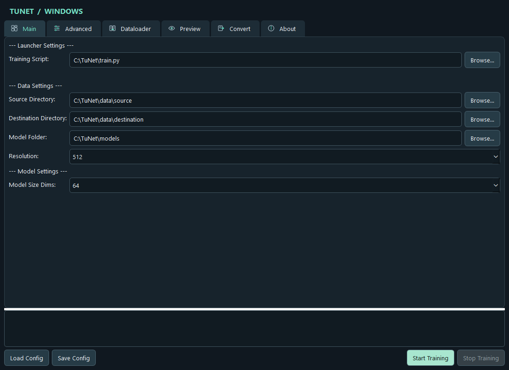
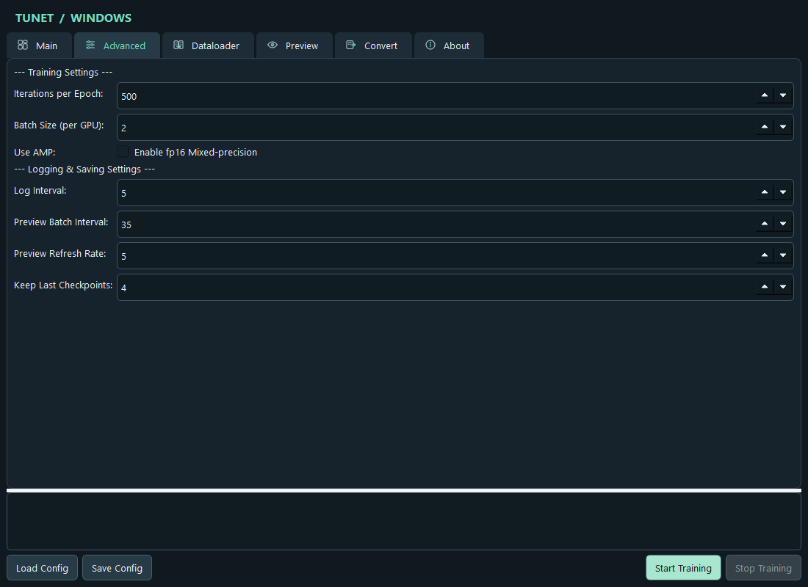
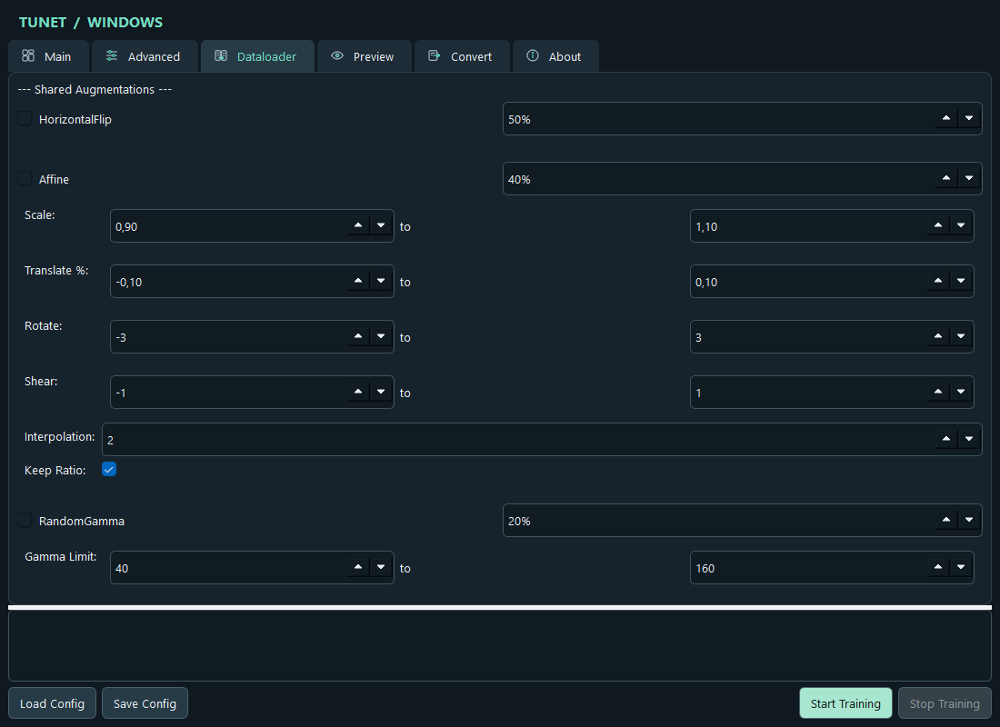
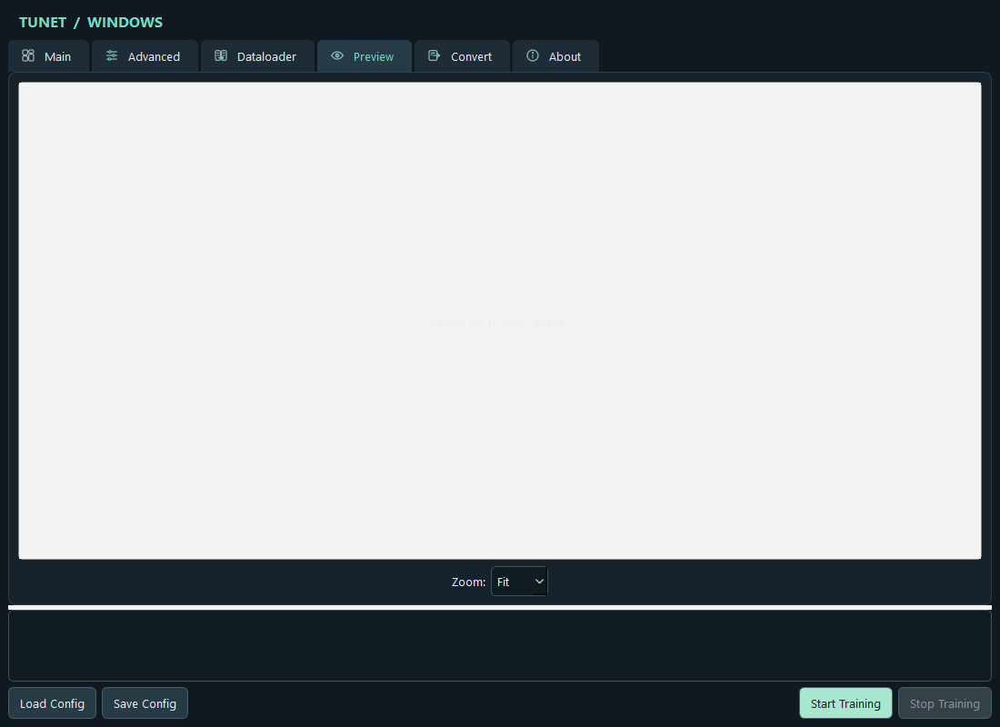
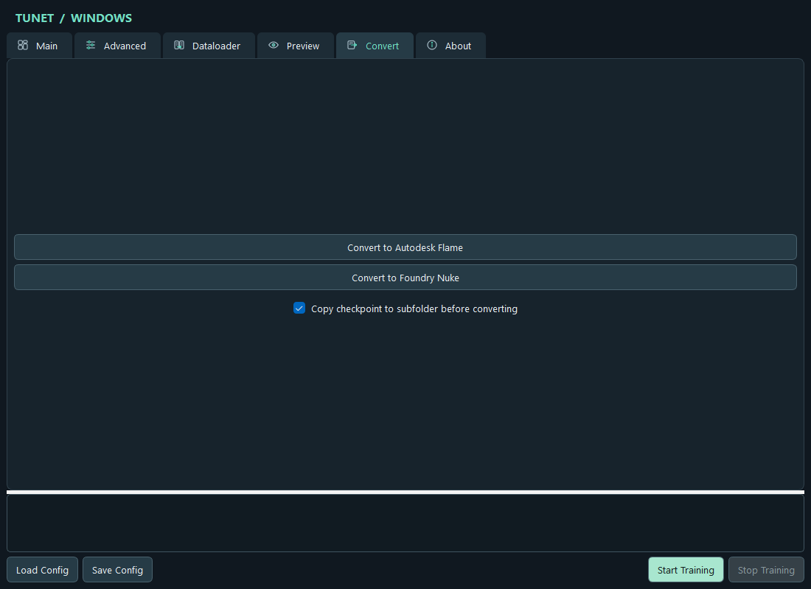
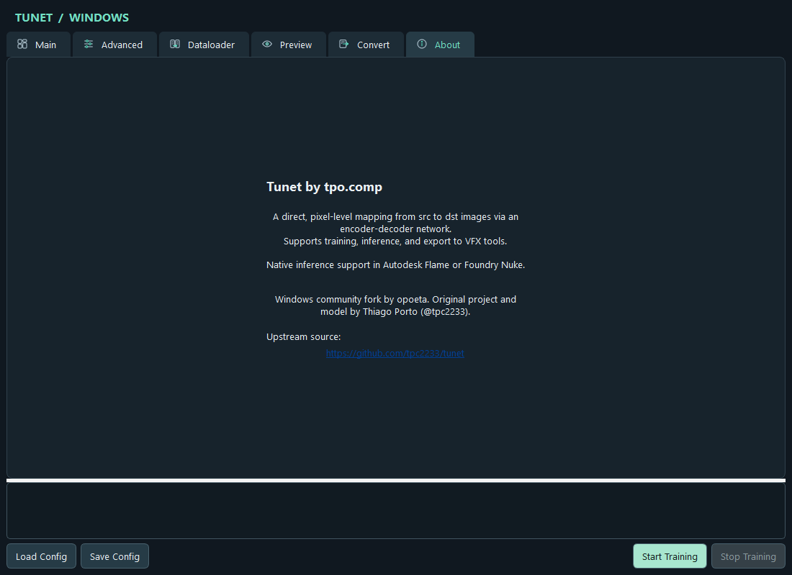

# TuNet for Windows

Windows community fork of [TuNet](https://github.com/tpc2233/tunet), an encoder-decoder for pixel-to-pixel image mapping. Original project and model by **Thiago Porto (@tpc2233)**. This fork adds Windows support, a PowerShell installer, and a Windows interface.

## Quick install

Open PowerShell and run:

```powershell
irm https://github.com/opoeta/tunet/releases/latest/download/install.ps1 | iex
```

The installer reads the `windows` branch tree from GitHub and downloads source files individually. It does not clone the repository or download/extract an archive. It installs Python 3.12 if needed, creates a private environment under `%LOCALAPPDATA%`, installs PyTorch with CUDA support and adds a Start menu shortcut.

For a CPU-only install, download only the installer script and invoke it with `-CpuOnly`:

```powershell
$installer = Join-Path $env:TEMP 'tunet-install.ps1'
irm https://github.com/opoeta/tunet/releases/latest/download/install.ps1 -OutFile $installer
& $installer -CpuOnly
```

A compatible NVIDIA driver is required for CUDA. The separate CUDA Toolkit is not required. Re-running the installer refreshes the application files from GitHub.

## Windows interface

Screenshots captured from the Windows Qt build. Paths are examples; choose your own paired image folders and model output folder before training.

### Main



### Training settings



### Data augmentation



### Preview



### Export



### About and upstream credit



## Developer setup

```powershell
git clone --branch windows --single-branch https://github.com/opoeta/tunet.git
cd tunet
py -3.12 -m venv .venv
.\.venv\Scripts\python.exe -m pip install torch torchvision --index-url https://download.pytorch.org/whl/cu132
.\.venv\Scripts\python.exe -m pip install onnx pyyaml lpips onnxruntime Pillow albumentations PySide6
.\.venv\Scripts\python.exe ui_app.py
```

Check CUDA availability:

```powershell
.\.venv\Scripts\python.exe -c "import torch; print(torch.__version__, torch.cuda.is_available(), torch.cuda.get_device_name(0) if torch.cuda.is_available() else 'CPU')"
```

## Credits and license

- Original project, model architecture, and model content: **Thiago Porto (@tpc2233)** — [tpc2233/tunet](https://github.com/tpc2233/tunet).
- This community fork is not maintained or endorsed by the upstream author.
- Apache-2.0: preserve the upstream copyright notices and [LICENSE](LICENSE).
